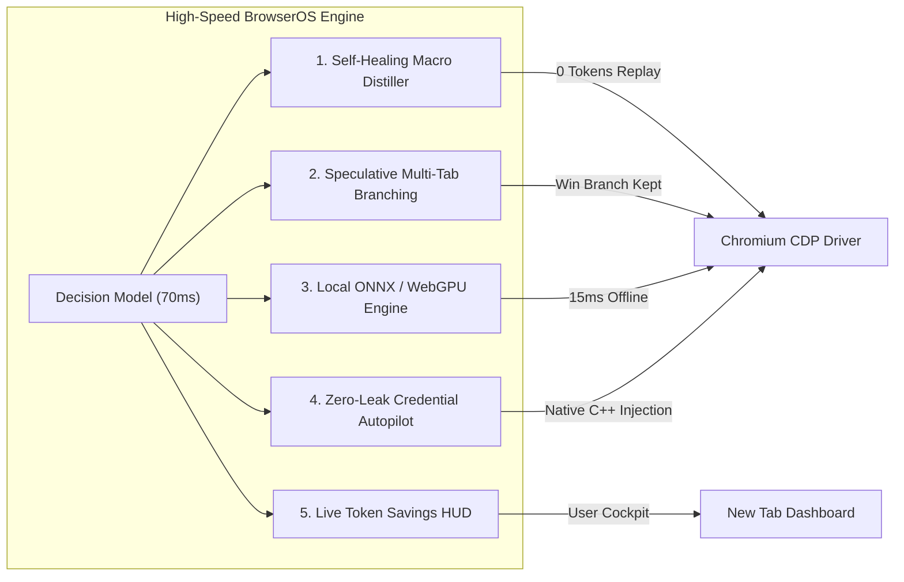
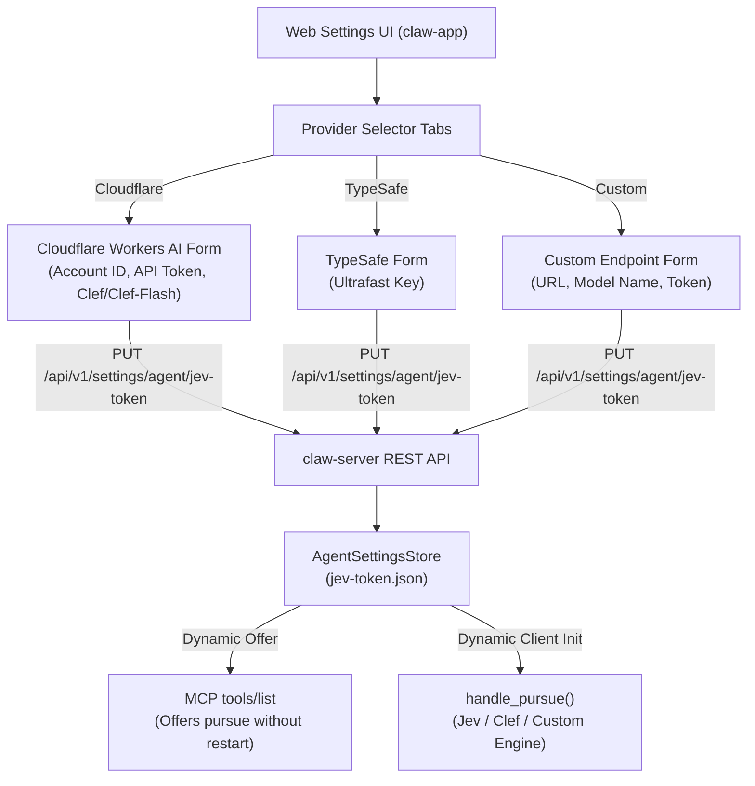

# Plan: Universal Decision Model Integration & Advanced Features for BrowserOS

## 1. Context & Architecture

**BrowserOS** (`browseros-ai/BrowserOS`) is an open-source, privacy-first agentic browser built on a Chromium fork with an embedded agent system (`packages/browseros-agent`).

Inside `packages/browseros-agent`, browser automation is driven by the **`browseros-decide`** Rust crate (`crates/browseros-decide`) and coordinated by the **`claw-server`** MCP agent.

---

## 2. Decision Model Catalog: From Free to Paid

| Tier | Model | Provider / Engine | Input Cost (per 1M) | Output Cost | Modality | Best For |
| :--- | :--- | :--- | :--- | :--- | :--- | :--- |
| **100% Free / Self-Hosted** | **Clef-Flash (9B)** | Hugging Face (`cloudflare/clef-flash-9b`, Apache 2.0) | **$0.00** | **$0.00** | Vision + Text | Local GPU / vLLM. Zero API cost, full privacy. |
| **100% Free / Self-Hosted** | **Kev-4B** | Hugging Face (`typesafe/kev-4b`, Apache 2.0) | **$0.00** | **$0.00** | Text / DOM | Ultra-lightweight CPU/GPU local decision routing. |
| **Cloudflare Workers AI** | **Clef-Flash (`@cf/cloudflare/clef-flash`)** | Cloudflare Workers AI | Free up to 10k neurons/day, then $0.011/1k neurons | **$0.00** | Vision + Text | Hosted on Cloudflare's edge network. Native vision & screenshot parsing. |
| **Cloudflare Workers AI** | **Clef (`@cf/cloudflare/clef`)** | Cloudflare Workers AI | Workers AI Neurons | **$0.00** | Vision + Text | 27B flagship variant for complex visual layouts. |
| **Low-Cost Pay-As-You-Go** | **Liquid d1** | OpenRouter (`liquid/d1`) | **~$0.02** | **$0.00** | Text / JSON | Fastest (~60ms) and cheapest non-transformer decision model. |
| **Low-Cost Pay-As-You-Go** | **Microsoft Decision-1** | OpenRouter / Azure (`microsoft/decision-1`) | **~$0.035** | **$0.00** | Text / JSON | Enterprise policy and tool choice classification. |
| **Low-Cost Pay-As-You-Go** | **TypeSafe Jev 1.13** | TypeSafe API / OpenRouter (`typesafe/jev-1.13`) | **~$0.042** | **$0.00** | Text / JSON | Current default in BrowserOS; robust 262k context. |

---

## 3. Dedicated Cloudflare Clef Integration

Cloudflare's **Clef** and **Clef-Flash** models are first-class citizens in this integration:

### Endpoint & Authentication
- **Worker AI Endpoint**:
  ```text
  https://api.cloudflare.com/client/v4/accounts/{account_id}/ai/run/@cf/cloudflare/clef-flash
  ```
- **Authentication**: Standard Cloudflare API Token passed via Bearer auth header:
  `Authorization: Bearer <CLOUDFLARE_API_TOKEN>`.
- **Environment Configuration**:
  - `CLOUDFLARE_ACCOUNT_ID`: Your Cloudflare Account ID.
  - `CLOUDFLARE_API_TOKEN`: Your Cloudflare Workers AI API Token.
  - `CLOUDFLARE_CLEF_MODEL`: `@cf/cloudflare/clef-flash` (default) or `@cf/cloudflare/clef`.

### Rust Native Cloudflare Clef Constructor in `client.rs`
```rust
pub const CLOUDFLARE_CLEF_FLASH: &str = "@cf/cloudflare/clef-flash";
pub const CLOUDFLARE_CLEF: &str = "@cf/cloudflare/clef";

impl Jev {
    /// Configures a client targeting Cloudflare Workers AI Clef / Clef-Flash
    pub fn for_cloudflare(account_id: &str, token: &str, model: Option<&str>) -> Self {
        let model_name = model.unwrap_or(CLOUDFLARE_CLEF_FLASH);
        let endpoint = format!(
            "https://api.cloudflare.com/client/v4/accounts/{account_id}/ai/run/{model_name}"
        );
        Self::new(token)
            .with_endpoint(endpoint)
            .with_model(model_name)
    }
}
```

---

## 4. Custom Endpoint Architecture: Bypassing the `/models` Route

### Problem
When connecting to private, self-hosted, or proxy endpoints (e.g. local vLLM, Ollama, private gateway):
1. Client libraries or proxies often attempt pre-flight requests to `GET /models` or `GET /v1/models` to validate model existence.
2. Custom inference servers frequently return `404 Not Found` or `403 Forbidden` on `/models`, or suffer connection timeouts in air-gapped environments.
3. Hardcoded model registries throw validation errors for custom model identifiers.

### Solution for `BrowserOS`
Implement **Zero-Registry Direct Inference**:
- Configurable via `DECISION_MODEL_ENDPOINT` and `DECISION_MODEL_NAME` (or UI settings in BrowserOS).
- The client in [`client.rs`](packages/browseros-agent/crates/browseros-decide/src/client.rs) directly executes `POST` requests to the configured endpoint URL without any pre-flight discovery call to `/models`.
- Accepts arbitrary model strings (e.g., `model = "clef-flash-9b"` or `model = "custom-lora-v1"`).

---

## 5. Engineering Mitigations for the 5 Major Failure Modes

1. **The Context Paradox (Input Token Accumulation)**:
   - Filter out non-visible DOM nodes in [`view.rs`](packages/browseros-agent/crates/browseros-decide/src/view.rs) and compute DOM delta hashes so repetitive polling on static pages does not re-bill input tokens.
2. **Choice Overflow (Action Space Explosion)**:
   - Enforce a strict candidate cap ($K \le 20$) in [`space.rs`](packages/browseros-agent/crates/browseros-decide/src/space.rs) prioritizing interactive elements (`button`, `input`, `a`, `select`) within the active viewport.
3. **Text Generation Gap**:
   - Detect in [`offer.rs`](packages/browseros-agent/crates/browseros-decide/src/offer.rs) when an input field requires novel creative generation versus known parameter values, routing complex text generation back to the parent agent.
4. **Loop Traps & Stagnation**:
   - Track the last 3 moves in [`gate.rs`](packages/browseros-agent/crates/browseros-decide/src/gate.rs). If identical actions fail to change the page state, mask the repeated choice and return a stagnation signal.
5. **Protocol Divergence Across Custom Endpoints**:
   - Extend [`client.rs`](packages/browseros-agent/crates/browseros-decide/src/client.rs) to support both the native TypeSafe `SystemOne` request payload and standard OpenAI-compatible `/chat/completions` with JSON schema enforcement.

---

## 6. Advanced Feature Suite



### Feature 1: Self-Healing Action Macro Distiller
- **Concept**: Compile successful multi-step decision runs (e.g., login $\rightarrow$ invoices $\rightarrow$ export CSV) into cached deterministic CDP scripts.
- **Benefit**: Subsequent runs execute in **0ms with 0 tokens**; the Decision Model only awakens if an element breaks or mutates ("self-healing").

### Feature 2: Speculative Multi-Tab Branching
- **Concept**: When probabilities are split between two candidate actions (e.g., Result A: 52%, Result B: 48%), fork tabs to explore both simultaneously.
- **Benefit**: Eliminates the 10-second penalty of clicking the wrong search link and pressing "Back".

### Feature 3: On-Device / Local Decision Inference (ONNX / WebGPU)
- **Concept**: Run quantized 2B–4B decision models locally within the Rust backend via `ort` (ONNX Runtime) or Chromium WebGPU.
- **Benefit**: **15ms response latency**, 100% offline autonomy, and zero network data egress.

### Feature 4: Zero-Leak Credential Autopilot
- **Concept**: Combine [`credentials.rs`](packages/browseros-agent/crates/browseros-mcp/src/tools/credentials.rs) with decision classification.
- **Benefit**: Identifies login and 2FA fields via the decision model, then injects secrets directly via native C++ CDP. No password or OTP is ever transmitted to an external LLM.

### Feature 5: Real-Time Token Savings & Cockpit HUD
- **Concept**: An interactive dashboard widget on the new tab showing running metrics:
  - Total output tokens avoided ($0 bill).
  - Wall-clock time saved (100ms vs 4,000ms).
  - Estimated dollar cost reduction compared to GPT-4o / Claude 3.5 Sonnet.

---

## 7. Technical Restrictions & Guardrails

| Feature | Inherent Restrictions & Technical Constraints | Engineered Guardrails & Mitigations |
| :--- | :--- | :--- |
| **Local Inference (ONNX / WebGPU)** | **RAM/VRAM Footprint**: A 4B–9B quantized model requires 4GB–8GB of RAM/VRAM. Machines with < 8GB RAM can suffer thrashing. | Implement hardware capability check on startup. Automatically fall back to remote HTTP endpoints if VRAM/RAM is below threshold. |
| **Macro Distiller** | **Dynamic DOM Drift**: Single-page apps (SPAs) with randomized class hashes or A/B testing can invalidate static selector paths. | Integrate with [`framework.rs`](packages/browseros-agent/crates/browseros-mcp/src/framework.rs): on macro failure, trigger immediate self-healing decision repair without halting the task. |
| **Multi-Tab Speculation** | **System Resource Limits**: Each Chromium tab uses 100MB–300MB of RAM. Unchecked branching can exhaust memory. | Enforce a strict concurrency cap ($N \le 2$ speculative tabs) and an aggressive 5-second kill timer on unselected branches. |
| **Credential Autopilot** | **Security & Phishing Risks**: Autofilling credentials into unexpected redirects or untrusted iframes risks secret leakage. | **Strict Origin Binding**: Passwords are only injected if `document.location.origin` strictly matches the verified Chrome login vault entry over HTTPS. |
| **Cloud Providers** | **Rate Limits & Free Tier Caps**: Cloudflare Workers AI free tier (10k neurons) exhausts after a few heavy turns. | Provide clear configuration switching between free self-hosted endpoints, pay-as-you-go APIs, and local runtimes. |

---

## 8. Implementation Roadmap & File Changes

1. **`browseros-decide/src/client.rs`**:
   - Add Cloudflare Clef constructor (`for_cloudflare`) supporting `@cf/cloudflare/clef-flash` and `@cf/cloudflare/clef`.
   - Add dynamic `with_endpoint` and `with_model` initialization from environment and settings.
   - Implement OpenAI-compatible JSON schema mode alongside native `/systemone`.
   - **Zero `/models` route calls**.
2. **`browseros-decide/src/view.rs` & `space.rs`**:
   - Add viewport $Y$-filtering and top-$K$ ($K \le 20$) element pruning.
3. **`browseros-decide/src/gate.rs`**:
   - Add 3-step action history masking to prevent loop traps.
4. **`claw-server/src/services/agent_settings.rs` & `service.rs`**:
   - Wire Cloudflare credentials (`CLOUDFLARE_ACCOUNT_ID`, `CLOUDFLARE_API_TOKEN`) and dynamic endpoint/model settings into `handle_pursue()`.
5. **Web Settings UI & Contract Integration**:
   - Wire multi-provider selection (Cloudflare Clef, TypeSafe Jev, Custom) into `apps/claw-app/screens/settings/UltrafastKey.tsx`.
   - Update `apps/claw-app/screens/settings/Settings.tsx` to un-gate decision settings and provide direct configuration.
   - Update OpenAPI contracts in `contracts/claw-api/schemas/settings.yaml`, `crates/claw-api/src/generated/settings.rs`, and TypeScript client libraries.
   - Save credentials and endpoint configuration persistently via `save_decision_config` in `agent_settings.rs`.
6. **Advanced Feature Integration**:
   - Connect the Macro Distiller in `framework.rs`.
   - Implement origin-bound credential autopilot in `credentials.rs`.

---

## 9. Web Settings UI Architecture



Users can configure, replace, or remove decision providers directly through the BrowserOS Settings panel with zero command-line configuration required.
